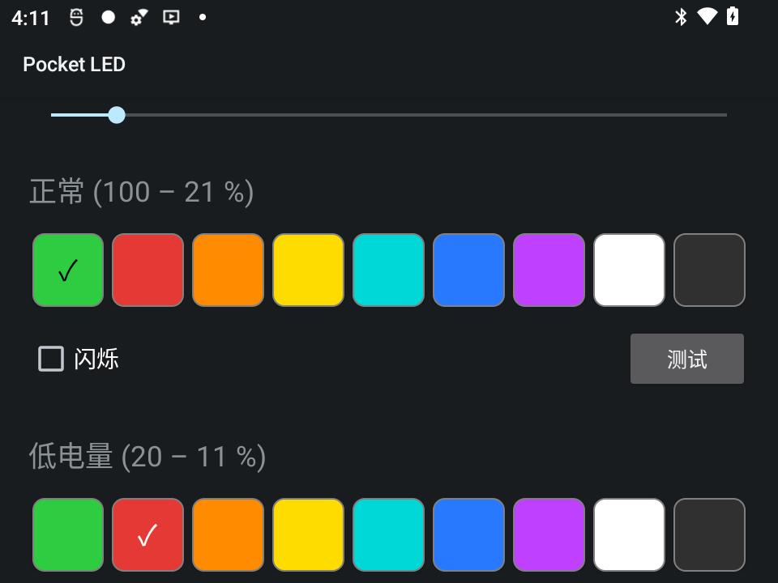
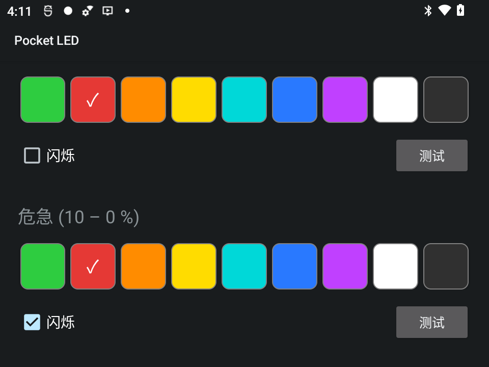

# Pocket LED 汉化版（简体中文）

[Pocket LED](https://github.com/Ninoh-FOX/led-control) 的中文版 —— 给 Pocket Block / KONKR 这类 Android 掌机用的电池指示灯控制工具。

原版界面是西班牙语，本仓库提供 **1.5 版**的简体中文 APK：不改功能、不改包名、不改布局，只把界面上的文字换成中文。

- 原项目：[Ninoh-FOX/led-control](https://github.com/Ninoh-FOX/led-control)（作者 Ninoh-FOX）
- 原版发布：v1.5
- 汉化版本：v1.5-zh（versionName 1.5 / versionCode 6）
- 汉化版下载：[Releases](../../releases/latest)

## 截图

| 主界面 | 三档指示灯设置 | 危急档 |
|---|---|---|
|  |  |  |

## 它做什么

Pocket Block 等掌机的电池指示灯（LED AW2023）在系统里就是一个 sysfs 节点，这个 App 按电量把灯显示成不同颜色：

- **正常 / 低电量 / 危急**三档，两个阈值（默认 20% / 10%）可拖动调整
- 每档单独配色（9 种颜色）和闪烁开关，亮度 1–15 全局调节
- 充电时把指示灯还给系统（由系统显示充电灯），不抢占
- 开机自启，常驻前台服务每 2 秒重刷一次颜色

## 安装

从 [Releases](../../releases/latest) 下载 `PocketLED-1.5-zh.apk`，直接装。

**先看这三条：**

1. **必须先卸载原版**。汉化版包名同样是 `com.pocketblock.led`，但签名不同，覆盖安装会报「应用未安装」。卸载原版会清掉你之前保存的设置（亮度、配色、阈值）。
2. 系统要求 **Android 8.0（API 26）及以上**。APK 使用 **v2 签名**，targetSdk 31。
3. 安装时若提示「未知来源」或「应用未经检测」，选择仍然安装即可。

SHA-256（安装前可自行核对）：

```
F86DACF1B0770BE92B0D82149E56E351F758A39DD5914FD9734CADC31AAF459E
```

## 汉化范围

| 位置 | 原文（西班牙语） | 译文 |
|---|---|---|
| 亮度滑块 | Brillo: 10 / 15 | 亮度：10 / 15 |
| 主开关 | Controlar el LED de batería | 控制电量指示灯 |
| 状态提示 | LED de batería detectado. | 已检测到电量指示灯。 |
| 不兼容提示 | No se puede escribir en el LED: esta consola no es compatible. | 无法写入指示灯：此设备不受支持。 |
| 加载说明 | Mientras la consola carga… "Probar" sigue funcionando. | 界面加载期间，指示灯由系统控制；"测试"仍然可用。 |
| 按钮 | Probar | 测试 |
| 复选框 | Parpadear | 闪烁 |
| 阈值文本 | Batería baja: 20 % o menos | 低电量阈值：20% 及以下 |
| 阈值文本 | Batería crítica: 10 % o menos | 危急电量阈值：10% 及以下 |
| 区间说明 | Normal (100 – 21 %) | 正常 (100 – 21 %) |
| 区间说明 | Baja (20 – 11 %) | 低电量 (20 – 11 %) |
| 区间说明 | Crítica (10 – 0 %) | 危急 (10 – 0 %) |
| 颜色名 | Verde, Rojo, Naranja, Amarillo, Cian, Azul, Violeta, Blanco, Apagado | 绿色、红色、橙色、黄色、青色、蓝色、紫色、白色、关闭 |
| 通知渠道 | Control del LED | 指示灯控制 |
| 通知标题 / 内容 | Pocket LED activo / Controlando el LED de batería | 正在运行 / 正在控制电量指示灯 |

**没动的部分：** 应用名与标题（保留品牌名 `Pocket LED`）、图标、主题、`resources.arsc`、`res/` 下的矢量图、包名、版本号、权限、组件、全部逻辑与布局。

「LED」作为通用缩写保留未译。

## 已验证

- 真机：Pocket Block（Android 12），安装、启动、逐档切换、通知、开机自启均已实际核对。
- APK 内 `classes.dex` 已重排字符串表并通过 ART 校验；签名块结构、内容摘要、RSA 验签、`resources.arsc` 4 字节对齐均复核通过。

## 已知限制

- 只在 **Pocket Block（LED AW2023）** 上验证过。KONKR Pocket Advance（LED AW2033）未测试，那台机器写 LED 节点通常需要 root，汉化版不会改变这一限制。
- 原版把界面文字写死在 Java 代码里（没有 `strings.xml`），所以汉化是直接改 DEX 字符串表。**原版一更新就必须重新制作**，无法靠资源替换自动跟进。
- 只汉化了界面文案，`adb logcat` 里的日志仍是原样。

## 授权与免责

- 上游 [Ninoh-FOX/led-control](https://github.com/Ninoh-FOX/led-control) **没有声明任何开源协议**，默认即「保留所有权利」。本仓库是**非官方修改版，未获得作者授权**，仅作学习交流与个人使用，请勿用于商业用途。
- 如果你喜欢这个 App，请去原仓库给作者点 star，或直接使用原版。
- 若原作者或权利人认为本仓库不妥，提出后我会立即删除相关内容。
- 刷机、写 sysfs 节点属于有风险的操作，因使用本汉化版造成的任何问题由使用者自行承担。

## 制作说明

改了什么、怎么改的、怎么校验的，见 [docs/汉化说明.md](docs/汉化说明.md)。
