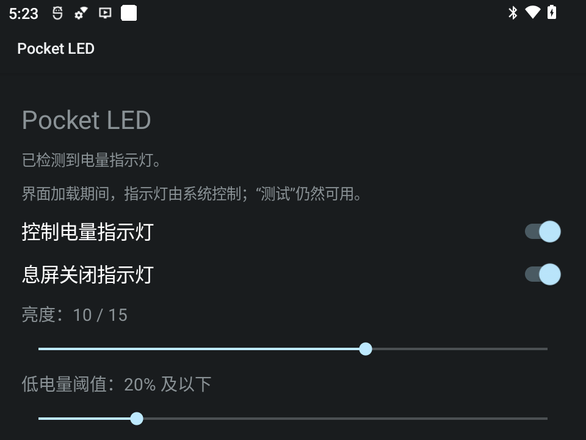

# Pocket LED 1.5.2 · 汉化版 + 熄屏关灯

把西班牙语的安卓掌机电池指示灯工具 **Pocket LED** 汉化为简体中文，并在汉化基础上新增一个原版没有的功能：
**熄屏 / 休眠时自动关闭指示灯**。

> 上游：[Ninoh-FOX/led-control](https://github.com/Ninoh-FOX/led-control) `v1.5`（包名 `com.pocketblock.led`，targetSdk 31，minSdk 26 → Android 8.0+）
> 本仓库是**非官方**汉化，与原作者无关，不含原作者源码。

**当前版本：1.5.2**（`versionName=1.5.2` / `versionCode=8`）——版本号已与上游 `1.5 / 6` 区分开，
装过一次旧版的话可以直接覆盖升级。更新内容见 [CHANGELOG.md](CHANGELOG.md)。

## 下载

| 文件 | 大小 | SHA-256 |
|---|---|---|
| [PocketLED-1.5.2-zh.apk](PocketLED-1.5.2-zh.apk) | 14,521 字节 | `E4C6609B7E5896826ADB96D36FC29C5EC8C257A615D00194BF0DFAC5108E8CE7` |

也可以从 [Releases](../../releases/latest) 取同一份文件。

## 功能

- 全界面中文化：开关、阈值、色块名、按钮、通知栏、状态提示
- **新增开关「息屏关闭指示灯」**
  - 打开：屏幕熄灭（含掌机休眠）后指示灯立刻熄灭，点亮屏幕后自动恢复原颜色 / 亮度 / 闪烁
  - 关闭：与原版一致，息屏也常亮
  - 设置持久化在 `SharedPreferences`（文件 `led`，键 `screenOff`）
- 应用名、图标、包名、权限、组件均保持原样；**版本号改为 1.5.2 / 8**（唯一一处与原版不同的元数据）

## 截图

真机 Android 12（960×720）截取：

| 主界面（含新增开关） | 正常 / 低电量分区 | 危急分区 |
|---|---|---|
|  |  |  |

## 安装

```bash
adb uninstall com.pocketblock.led      # 只有从「原版」转过来才需要：签名不同，无法覆盖装
adb install PocketLED-1.5.2-zh.apk
```

- **从本仓库的旧版（1.5-zh / 1.5.1-zh）升级**：签名相同，直接 `adb install -r` 或点开新 APK 覆盖安装，
  亮度 / 配色 / 阈值设置都会保留。
- **从上游原版转过来**：必须先卸载原版，卸载会清空它保存的设置。
- 系统要求 Android 8.0（API 26）及以上；APK 使用 **APK Signature Scheme v2** 自签名（RSA-2048，自签证书）。

## 改了什么（摘要）

完整对照表在 [docs/汉化说明.md](docs/汉化说明.md)。

- 翻译 30 条硬编码文案：`Brillo: 8 / 15` → `亮度：8 / 15`、`Controlar el LED de batería` → `控制电量指示灯`、
  `Probar` → `测试`、`Parpadear` → `闪烁`、`Batería baja/crítica` → `低电量/危急阈值` ……
- 新增 `Config.screenOff()` / `Config.setScreenOff()`、`LedService.screenOn()`、`MainActivity.screenOffRow()`，
  并给 `LedService.tick()` 插入前置判断
- **未改动**：`Pocket LED` 品牌名、图标、主题、布局、`resources.arsc`、`res/` 下矢量图、包名、权限、组件

## 实现要点（本机没有 apktool / Android SDK / java / 外网）

原 APK 的 UI 全部由代码构建，文案是 DEX 里的硬编码字符串常量。汉化要改字符串，新增开关还要插字节码，
所以解析、反汇编、汇编、整文件重建、打包、v2 签名全部用 Python 手写（`tools/`）：

| 脚本 | 作用 |
|---|---|
| `tools/dexlib.py` | DEX 解析 / 反汇编（全 256 opcode）/ 汇编 / 编码 |
| `tools/dexbuild.py` | 从 spec 重建整份 DEX（分段落盘、4 字节对齐、SHA-1 + adler32） |
| `tools/reindex.py` | 译文重排字符串表 + 全量重写索引引用（ART 强制 `string_ids` 升序） |
| `tools/patch_feature.py` | 追加「熄屏时关闭指示灯」：新增方法 + 字节码插入 + 索引 remap |
| `tools/bump_version.py` | 重写二进制 AXML 的 `versionName` / `versionCode`（只重建 string pool） |
| `tools/build_apk.py` | 手写 ZIP + APK Signing Block（v2） |
| `tools/verify_apk.py` | 签名块结构、内容摘要、RSA 验签、zip CRC、`resources.arsc` 对齐 |

> `tools/` 里的脚本是给这台机器写的，路径按作者本机的 `pocketled/` 目录写死（Windows 绝对路径），
> 挪到别处要先把根路径换成你们自己的。

几个关键坑（细节见 [docs/汉化说明.md](docs/汉化说明.md)）：

- **`string_ids` 必须按 UTF-16 升序**，否则 ART 直接 `Out-of-order string_ids`
- **22b 指令格式**是 `unit0 = op|A<<8`、`unit1 = B | lit8<<8`；按「A 只有 4 位」解会把自增循环写成死循环（黑屏 / ANR）
- 重建 DEX 时**必须写回 `static_values`**（`Led.DIR`、闪烁间隔等），否则类初始化失败
- v2 签名的 `digests` / `signatures` 是「长度前缀的序列，序列里每条记录**还要**一层长度前缀」

## 校验状态

- 编码器与原文 **83/83 个方法逐字节一致**
- `verify_apk.py` → `ALL CHECKS PASSED`（内容摘要重算、RSA 验签、zip CRC、arsc 对齐全部通过）
- 真机（Android 12 / arm64）实测：覆盖安装后 `versionName=1.5.2` / `versionCode=8`，启动、切开关、息屏、亮屏恢复均正常
- `AndroidManifest.xml` 的版本号改写做了往返测试：`1.5` → `1.5.1` → `1.5` 后与原文件**逐字节相同**

## 目录

```
PocketLED-1.5.2-zh.apk   成品（汉化 + 息屏关灯，1.5.2 / 8）
CHANGELOG.md             版本更新记录
docs/汉化说明.md          完整改动对照表、技术做法、踩坑记录
screenshots/             真机截图
tools/                   自研 DEX / AXML / ZIP / 签名工具链
```

## 授权与免责

- 上游仓库**未声明开源协议**（默认保留所有权利），本汉化为**非官方修改、未获作者授权**，
  仅作学习交流与个人使用。**若原作者提出异议，本仓库会立即删除。**
- 刷机 / 装第三方 APK 有风险，请自行判断；因使用本 APK 造成的任何损失作者不承担责任。
- 喜欢这个 App 的话，请去上游给原作者点个 star。

## 回退

`adb uninstall com.pocketblock.led` 即可移除；上游原始 APK 未被修改。
